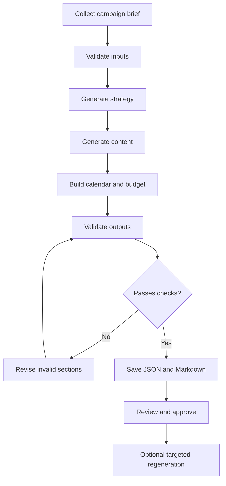

# CampaignPilot — Pi AI Marketing Campaign Extension

**Implementation blueprint (MVP → complete portfolio project)**  
**Target machine:** macOS (Apple Silicon or Intel)  
**Developer workflow:** Codex-assisted, TypeScript, Node.js, Pi agent harness  
**Status:** Code blueprint to implement and verify locally; not claimed to be tested against your machine or provider.

> **The goal:** Develop a real extension to Pi, not a generic chatbot website. Pi handles the conversation and model access. Your extension owns input schemas, marketing workflows, campaign persistence, export, validation, testing, and revision.

## 0. Roadmap and definition of done

| Phase | User-facing outcome | Engineering evidence |
|---|---|---|
| MVP | `/campaign` asks for inputs; agent generates campaign; `campaign_save` saves validated JSON and Markdown | Pi command and model-callable tool, Zod validation, safe local exports |
| V1 | Load existing campaigns and regenerate one section without destroying the original | Load and revision tools, deterministic storage, revision history |
| V2 | Evaluate campaign quality, budget integrity, campaign KPIs and export calendar CSV | Pure functions, test coverage, evaluation rubric |
| Portfolio-ready | Installable package, CI, demo, thorough README, secure defaults | Engineering craftsmanship and reproducibility |

**MVP acceptance criteria**

- [ ] `pi --extension ./.pi/extensions/campaignpilot.ts` loads without error.
- [ ] `/campaign` starts a campaign planning conversation.
- [ ] Model obtains a structured brief and produces a campaign matching the schema.
- [ ] Model uses `campaign_save` to persist campaign files in `./campaigns/<safe-id>/`.
- [ ] Invalid inputs receive descriptive validation errors; no files are written.
- [ ] Campaign JSON and Markdown include strategy, posts, calendar, budget and KPIs.
- [ ] No API credentials or personal customer data are committed.
- [ ] Unit tests pass.

**Non-goals for MVP:** Posting to real social media, scraping competitors, real ad purchases, web UI, multi-agent orchestration, image/video generation, and a custom AI inference service.

## 1. Marketing domain model

A marketing campaign is a **goal-oriented set of planned activities** designed to reach a specific audience within a time window and budget.

### Required inputs

| Field | Example | Reason |
|---|---|---|
| Brand | Bean & Brew | Who is running the campaign |
| Product | Matcha latte | What is promoted |
| Audience | College students in HCMC | Who receives the message |
| Goal | awareness / traffic / leads / sales | What is optimized |
| Total budget | 3,000,000 VND | Constrains channel allocation |
| Duration | 14 days | Constrains the calendar |
| Channels | Instagram, TikTok | Where creative is published |
| Differentiator | Made fresh and under 50k VND | Reasons to choose brand |
| Brand voice | Friendly, youthful | Copywriting consistency |
| Constraints | No health claims, no invented discounts | Brand safety |

### Required outputs

1. Strategy: objective, value proposition, key message, audience insights.
2. Content: platform-specific post drafts, hooks, calls to action, hashtags.
3. Calendar: publishing schedule with day offset, platform and content ID.
4. Budget: channel allocations with amounts summing to the input budget.
5. KPIs: metrics, targets (estimates, not facts), and tracking method.
6. Review notes: uncertainties, assumptions and warnings.

### Business workflow



**Important architectural rule:** The AI proposes marketing decisions; deterministic application code validates invariants (budget sums, valid channels, content references, timeline, safe paths). Never trust model-generated JSON without validation.

## 2. Install on Mac

Install **Node.js 22.19+** (using `nvm`, Homebrew or official installer). Check:

```bash
node -v
npm -v
git --version
```

Pi's current official macOS installer:

```bash
curl -fsSL https://pi.dev/install.sh | sh
pi --version
```

Alternatively, with Node.js 22.19+ already installed:

```bash
npm install -g --ignore-scripts @earendil-works/pi-coding-agent
```

**Safety tip:** Inspect installer scripts before running them if you are unsure of their source. Pi extensions execute with your OS user permissions; use trusted code only.

Set up the repository:

```bash
mkdir campaignpilot && cd campaignpilot
git init
npm init -y
npm install zod @sinclair/typebox
npm install -D typescript tsx vitest @types/node @earendil-works/pi-coding-agent
mkdir -p .pi/extensions src tests examples campaigns
```

Start Pi and connect an AI provider with `/login`, then use `/model` to choose a model. **You do not need Vilao to start.** If you use Vilao later, verify its API endpoint and exact model identifier and configure Pi's `~/.pi/agent/models.json`. Do not assume OpenAI-compatible means every model/tool-call capability works. See [Pi model setup](https://pi.dev/docs/latest/models).

To use Codex, open the `campaignpilot` directory in your Codex environment and give it **one small implementation task at a time**. Review every patch and run the tests yourself.

## 3. Repository layout

```text
campaignpilot/
├── .pi/extensions/
│   └── campaignpilot.ts         # Pi extension entry point
├── src/
│   ├── schema.ts                # Zod schema and TS types
│   ├── storage.ts               # Secure file storage
│   ├── render.ts                # Markdown export
│   ├── checks.ts                # Domain invariants
│   ├── review.ts                # Full-project quality evaluation (V2)
│   └── csv.ts                   # Full-project calendar export (V2)
├── examples/
│   └── brief.json
├── tests/
│   ├── checks.test.ts
│   └── storage.test.ts
├── campaigns/                    # Generated, ignored by git
├── package.json
├── tsconfig.json
├── .gitignore
└── README.md
```

## 4. MVP — copy these files first

### 4.1 `package.json`

Merge the scripts below into the `package.json` generated by `npm init`. Keep the dependency versions resolved by your `npm install` commands rather than copying possibly stale version pins.

```json
{
  "name": "campaignpilot",
  "private": true,
  "type": "module",
  "scripts": {
    "dev": "pi --extension ./.pi/extensions/campaignpilot.ts",
    "test": "vitest run",
    "typecheck": "tsc --noEmit"
  }
}
```

### 4.2 `tsconfig.json`

```json
{
  "compilerOptions": {
    "target": "ES2022",
    "module": "NodeNext",
    "moduleResolution": "NodeNext",
    "lib": ["ES2022", "DOM"],
    "strict": true,
    "esModuleInterop": true,
    "skipLibCheck": true,
    "noEmit": true,
    "types": ["node"]
  },
  "include": ["src/**/*.ts", "tests/**/*.ts", ".pi/extensions/**/*.ts"]
}
```

### 4.3 `.gitignore`

```gitignore
node_modules/
campaigns/
.env
.env.*
!.env.example
.DS_Store
coverage/
```

### 4.4 `src/schema.ts`

```typescript
import { z } from "zod";

export const Channel = z.enum(["instagram", "tiktok", "facebook", "email"]);

export const BriefSchema = z.object({
  brand: z.string().trim().min(2).max(100),
  product: z.string().trim().min(2).max(200),
  audience: z.string().trim().min(5).max(500),
  goal: z.enum(["awareness", "traffic", "leads", "sales"]),
  budgetVnd: z.number().int().positive().max(1_000_000_000),
  durationDays: z.number().int().min(1).max(90),
  channels: z.array(Channel).min(1).max(4).refine(
    (xs) => new Set(xs).size === xs.length,
    "Channels must be unique",
  ),
  differentiator: z.string().trim().min(3).max(500),
  voice: z.string().trim().min(2).max(150),
  constraints: z.array(z.string().max(300)).default([]),
});

export const PostSchema = z.object({
  id: z.string().regex(/^[a-z0-9-]{1,60}$/),
  channel: Channel,
  title: z.string().min(3).max(150),
  caption: z.string().min(10).max(3000),
  cta: z.string().min(2).max(200),
  hashtags: z.array(z.string().max(80)).max(15),
});

export const CampaignSchema = z.object({
  brief: BriefSchema,
  strategy: z.object({
    campaignName: z.string().min(3).max(120),
    positioning: z.string().min(10).max(1000),
    keyMessage: z.string().min(5).max(500),
    audienceInsight: z.string().min(10).max(1000),
  }),
  posts: z.array(PostSchema).min(1).max(100),
  calendar: z.array(z.object({
    day: z.number().int().min(1).max(90),
    postId: z.string(),
    channel: Channel,
  })).min(1).max(200),
  budget: z.array(z.object({
    channel: Channel,
    amountVnd: z.number().int().nonnegative(),
    rationale: z.string().min(5).max(500),
  })).min(1).max(4),
  kpis: z.array(z.object({
    metric: z.string().min(2).max(120),
    target: z.string().min(1).max(120),
    measurement: z.string().min(3).max(400),
  })).min(1).max(15),
  assumptions: z.array(z.string().max(500)).default([]),
});

export type Brief = z.infer<typeof BriefSchema>;
export type Campaign = z.infer<typeof CampaignSchema>;
```

### 4.5 `src/checks.ts`

```typescript
import { CampaignSchema, type Campaign } from "./schema.js";

export function validateCampaign(input: unknown): Campaign {
  const campaign = CampaignSchema.parse(input);
  const { brief, posts, calendar, budget } = campaign;
  const errors: string[] = [];

  const postMap = new Map(posts.map((post) => [post.id, post]));
  if (postMap.size !== posts.length) errors.push("Duplicate post IDs");

  const channels = new Set(brief.channels);
  for (const post of posts) {
    if (!channels.has(post.channel)) errors.push(`Post ${post.id}: unselected channel`);
  }
  for (const entry of calendar) {
    if (entry.day > brief.durationDays) errors.push(`Calendar day ${entry.day} exceeds duration`);
    const post = postMap.get(entry.postId);
    if (!post) errors.push(`Unknown post ID ${entry.postId}`);
    else if (post.channel !== entry.channel) errors.push(`Channel mismatch for ${entry.postId}`);
  }
  const seen = new Set<string>();
  for (const item of budget) {
    if (!channels.has(item.channel)) errors.push(`Budget uses unselected channel ${item.channel}`);
    if (seen.has(item.channel)) errors.push(`Duplicate budget channel ${item.channel}`);
    seen.add(item.channel);
  }
  const allocated = budget.reduce((sum, item) => sum + item.amountVnd, 0);
  if (allocated !== brief.budgetVnd) {
    errors.push(`Budget sums to ${allocated}, expected ${brief.budgetVnd}`);
  }
  if (errors.length) throw new Error(`Campaign validation failed:\n- ${errors.join("\n- ")}`);
  return campaign;
}
```

### 4.6 `src/render.ts`

```typescript
import type { Campaign } from "./schema.js";

export function renderMarkdown(c: Campaign): string {
  const lines: string[] = [
    `# ${c.strategy.campaignName}`,
    "", "## Brief",
    `- Brand: ${c.brief.brand}`,
    `- Product: ${c.brief.product}`,
    `- Audience: ${c.brief.audience}`,
    `- Goal: ${c.brief.goal}`,
    `- Duration: ${c.brief.durationDays} days`,
    `- Budget: ${c.brief.budgetVnd.toLocaleString("en-US")} VND`,
    "", "## Strategy",
    `**Positioning:** ${c.strategy.positioning}`,
    `**Key message:** ${c.strategy.keyMessage}`,
    `**Audience insight:** ${c.strategy.audienceInsight}`,
    "", "## Content",
  ];
  for (const post of c.posts) {
    lines.push("", `### ${post.id}: ${post.title} (${post.channel})`,
      post.caption, `**CTA:** ${post.cta}`,
      `**Hashtags:** ${post.hashtags.join(" ")}`);
  }
  lines.push("", "## Calendar", "", "| Day | Channel | Post ID |", "|---|---|---|");
  for (const item of c.calendar) lines.push(`| ${item.day} | ${item.channel} | ${item.postId} |`);
  lines.push("", "## Budget", "", "| Channel | VND | Rationale |", "|---|---:|---|");
  for (const b of c.budget) lines.push(`| ${b.channel} | ${b.amountVnd} | ${b.rationale.replaceAll("|", "\\|")} |`);
  lines.push("", "## KPIs");
  for (const k of c.kpis) lines.push(`- **${k.metric}** — proposed target: ${k.target}; measurement: ${k.measurement}`);
  lines.push("", "## Assumptions / items for human review");
  for (const a of c.assumptions) lines.push(`- ${a}`);
  lines.push("", "> Draft only. Validate all factual claims, prices, budget recommendations, and legal requirements before publishing.", "");
  return lines.join("\n");
}
```

### 4.7 `src/storage.ts`

Each save creates a new directory, rather than overwriting an earlier campaign. IDs must be safe and generated by our code (never accept a free-form model path).

```typescript
import { mkdir, writeFile, readFile } from "node:fs/promises";
import { randomUUID } from "node:crypto";
import path from "node:path";
import { validateCampaign } from "./checks.js";
import { renderMarkdown } from "./render.js";
import type { Campaign } from "./schema.js";

const ID_PATTERN = /^[0-9a-f]{8}-[0-9a-f-]{27,}$/i;

export function campaignRoot(cwd: string): string {
  return path.resolve(cwd, "campaigns");
}

export async function saveCampaign(cwd: string, input: unknown) {
  const campaign = validateCampaign(input);
  const id = randomUUID();
  const folder = path.join(campaignRoot(cwd), id);
  await mkdir(folder, { recursive: true });
  await writeFile(path.join(folder, "campaign.json"), JSON.stringify(campaign, null, 2) + "\n", { encoding: "utf8", flag: "wx" });
  await writeFile(path.join(folder, "campaign.md"), renderMarkdown(campaign), { encoding: "utf8", flag: "wx" });
  return { id, folder, campaign };
}

export async function loadCampaign(cwd: string, id: string): Promise<Campaign> {
  if (!ID_PATTERN.test(id)) throw new Error("Invalid campaign ID");
  const filename = path.join(campaignRoot(cwd), id, "campaign.json");
  return validateCampaign(JSON.parse(await readFile(filename, "utf8")));
}
```

**Storage note:** For a single-developer local project this is sufficient to begin; for a production-grade package also protect against symlinked `campaigns` directories and partial saves (temporary directory + atomic rename), and consider locking for concurrent modifications.

### 4.8 `.pi/extensions/campaignpilot.ts`

This is the actual Pi extension. `/campaign` sends a planning instruction to Pi; the model fills in the schema and calls the model-callable `campaign_save` tool. Pi itself communicates with the model — no second HTTP request from our code.

```typescript
import type { ExtensionAPI } from "@earendil-works/pi-coding-agent";
import { Type } from "@sinclair/typebox";
import { saveCampaign } from "../../src/storage.js";

const SaveInput = Type.Object({
  campaign: Type.Any({ description: "A complete campaign object matching the campaign structure in the prompt" }),
});

const CAMPAIGN_INSTRUCTIONS = `
You are a marketing campaign planning assistant. Ask the user for missing
required facts instead of inventing them. Required brief: brand, product,
audience, goal (awareness/traffic/leads/sales), budgetVnd (integer),
durationDays (integer 1..90), channels (instagram/tiktok/facebook/email),
differentiator, voice, constraints (array).

When you have enough information, create a campaign object with EXACT keys:
{
  "brief": { "brand": "...", "product": "...", "audience": "...",
    "goal": "awareness", "budgetVnd": 3000000,
    "durationDays": 14, "channels": ["instagram", "tiktok"],
    "differentiator": "...", "voice": "...", "constraints": [] },
  "strategy": { "campaignName": "...", "positioning": "...",
    "keyMessage": "...", "audienceInsight": "..." },
  "posts": [{ "id": "post-1", "channel": "instagram", "title": "...",
    "caption": "...", "cta": "...", "hashtags": ["#brand"] }],
  "calendar": [{ "day": 1, "postId": "post-1", "channel": "instagram" }],
  "budget": [{ "channel": "instagram", "amountVnd": 3000000,
    "rationale": "..." }],
  "kpis": [{ "metric": "Reach", "target": "Estimate only: ...",
    "measurement": "..." }],
  "assumptions": []
}

The object may include multiple posts, calendar entries, budget channels, KPIs.
Use only selected channels. Calendar day is 1..durationDays. All postIds must
exist and channels must match. Budget amounts must sum EXACTLY to budgetVnd.
All text fields should be substantive, not placeholders. Do not invent facts,
performance results, discounts, endorsements or guarantees. Add assumptions
when facts need human confirmation.

IMPORTANT: Call the campaign_save tool with the campaign object to validate
and save it. If validation fails, fix the structure and retry. Then tell the
user the saved campaign ID, output file paths and concise summary.
`;

export default function (pi: ExtensionAPI) {
  pi.registerCommand("campaign", {
    description: "Create a structured marketing campaign",
    handler: async (args, ctx) => {
      const brief = args.trim();
      ctx.ui.notify("Starting CampaignPilot", "info");
      pi.sendUserMessage(`${CAMPAIGN_INSTRUCTIONS}\n\nUser brief: ${brief || "Please interview me to gather the required brief."}`);
    },
  });

  pi.registerTool({
    name: "campaign_save",
    label: "Save Campaign",
    description: "Validate a complete marketing campaign and export JSON + Markdown under the current project's campaigns directory.",
    parameters: SaveInput,
    async execute(_toolCallId, params, _signal, _onUpdate, ctx) {
      const result = await saveCampaign(ctx.cwd, params.campaign);
      return {
        content: [{ type: "text", text: `Saved campaign ${result.id} to ${result.folder} (campaign.json, campaign.md)` }],
        details: { id: result.id, folder: result.folder },
      };
    },
  });
}
```

**Why the tool takes `Type.Any`:** This small MVP passes the model's campaign object to Zod at runtime, so validation stays centralized. Once it works, replace `Type.Any` with a TypeBox schema mirroring the Zod structure; that gives the model stricter tool-call guidance.

**Pi API caution:** APIs evolve. If your installed version reports an incompatible `registerTool` or `sendUserMessage` signature, ask Codex to compare this file with [current Pi extension docs](https://pi.dev/docs/latest/extensions) and installed TypeScript declarations, then update the adapter without weakening domain validation.

### 4.9 `examples/brief.json`

```json
{
  "brand": "Bean & Brew",
  "product": "New matcha latte",
  "audience": "University students aged 18–25 in Ho Chi Minh City",
  "goal": "awareness",
  "budgetVnd": 3000000,
  "durationDays": 14,
  "channels": ["instagram", "tiktok"],
  "differentiator": "Made fresh with customizable sweetness",
  "voice": "Friendly, energetic, honest",
  "constraints": ["Do not invent discounts", "Do not make health claims"]
}
```

### 4.10 First run

```bash
npm run typecheck
npm run dev
```

Then in the Pi interactive terminal:

```text
/campaign Create an awareness campaign for Bean & Brew's new matcha latte.
```

Answer questions until the brief is complete. The agent should call `campaign_save` and create `campaigns/<id>/campaign.json` and `.md`.

Troubleshooting:

1. `/campaign` unknown: confirm the file path and that the extension loaded; restart with `npm run dev`.
2. Model doesn't call the tool: verify the model supports tool calling and that `campaign_save` is active in Pi.
3. Zod error: inspect the error and have the model repair only the invalid fields.
4. Authentication error: fix Pi `/login` or `/model`; don't add an API key to source files.
5. Type checking error: inspect locally installed Pi API types; never suppress errors with `as any` everywhere.

## 5. MVP testing

### 5.1 `tests/checks.test.ts`

```typescript
import { describe, expect, it } from "vitest";
import { validateCampaign } from "../src/checks.js";

const sample = {
  brief: {
    brand: "Bean & Brew", product: "Matcha latte",
    audience: "University students in Ho Chi Minh City", goal: "awareness",
    budgetVnd: 3000000, durationDays: 14,
    channels: ["instagram", "tiktok"],
    differentiator: "Customizable sweetness", voice: "Friendly", constraints: [],
  },
  strategy: {
    campaignName: "Matcha Moments", positioning: "Refreshing study break for students",
    keyMessage: "Take a matcha break", audienceInsight: "Students look for convenient breaks",
  },
  posts: [
    { id: "post-1", channel: "instagram", title: "Matcha break",
      caption: "A fresh matcha latte for your study break.", cta: "Visit us",
      hashtags: ["#matcha"] },
  ],
  calendar: [{ day: 1, postId: "post-1", channel: "instagram" }],
  budget: [
    { channel: "instagram", amountVnd: 2000000, rationale: "Reach students with short visuals" },
    { channel: "tiktok", amountVnd: 1000000, rationale: "Test creator-style videos" },
  ],
  kpis: [{ metric: "Reach", target: "Proposed: 10000", measurement: "Platform analytics" }],
  assumptions: ["Budget allocation is a draft"],
};

describe("campaign validation", () => {
  it("accepts a complete campaign", () => {
    expect(validateCampaign(sample).posts).toHaveLength(1);
  });
  it("rejects budget mismatch", () => {
    const bad = structuredClone(sample);
    bad.budget[0].amountVnd = 1;
    expect(() => validateCampaign(bad)).toThrow(/Budget sums/);
  });
  it("rejects unknown calendar posts", () => {
    const bad = structuredClone(sample);
    bad.calendar[0].postId = "missing";
    expect(() => validateCampaign(bad)).toThrow(/Unknown post ID/);
  });
  it("rejects days outside campaign duration", () => {
    const bad = structuredClone(sample);
    bad.calendar[0].day = 30;
    expect(() => validateCampaign(bad)).toThrow(/exceeds duration/);
  });
});
```

### 5.2 Run checks

```bash
npm test
npm run typecheck
```

**Integration test checklist (manual):** generate a campaign; inspect both files; force a wrong budget and confirm it is rejected; try duplicate post IDs; repeat with a second brand; restart Pi and confirm saved files persist.

---

# PART II — Build the complete version

Keep the MVP running throughout. Each feature below is a separate commit and independently testable.

## 6. V1 feature: inspect previously saved campaigns

Extend `.pi/extensions/campaignpilot.ts`:

```typescript
import { loadCampaign } from "../../src/storage.js";

// Place inside export default function (pi: ExtensionAPI) { ... }
pi.registerTool({
  name: "campaign_load",
  label: "Load Campaign",
  description: "Load an existing campaign by its generated ID.",
  parameters: Type.Object({ id: Type.String() }),
  async execute(_toolCallId, params, _signal, _onUpdate, ctx) {
    const campaign = await loadCampaign(ctx.cwd, params.id);
    return {
      content: [{ type: "text", text: JSON.stringify(campaign) }],
      details: { id: params.id },
    };
  },
});
```

**Note:** Place imports at top level and registration inside the existing factory; the code above is an insertion, not a second independent file.

Example interaction: "Load campaign `<id>` and summarize the creative strategy." Save tool output must be truncated if campaigns become large; keep the complete file on disk.

## 7. V1 feature: safely regenerate a single section

Regeneration workflow:

1. User specifies campaign ID and section (`strategy`, `posts`, `calendar`, `budget`, `kpis`).
2. Extension loads original.
3. Pi model proposes a new full campaign object, changing **only the requested section and any strictly dependent fields**.
4. Extension validates the new campaign and verifies approved unchanged sections.
5. Save a **new revision**, never overwrite the original. Preserve `parentId` and `reason` as metadata in a separate `revision.json` file.
6. Show a short diff; human approves the new revision for use.

Starter implementation in `src/revisions.ts`:

```typescript
import { writeFile } from "node:fs/promises";
import path from "node:path";
import { saveCampaign, loadCampaign } from "./storage.js";
import { validateCampaign } from "./checks.js";
import type { Campaign } from "./schema.js";

type Section = "strategy" | "posts" | "calendar" | "budget" | "kpis";
const editable: Section[] = ["strategy", "posts", "calendar", "budget", "kpis"];

export async function saveRevision(
  cwd: string, parentId: string, section: Section,
  input: unknown, reason: string,
) {
  if (!editable.includes(section)) throw new Error("Invalid section");
  const before = await loadCampaign(cwd, parentId);
  const after: Campaign = validateCampaign(input);
  if (JSON.stringify(before.brief) !== JSON.stringify(after.brief))
    throw new Error("Brief cannot change during section regeneration");

  for (const key of editable) {
    if (key !== section && JSON.stringify(before[key]) !== JSON.stringify(after[key])) {
      throw new Error(`Unexpected change to ${key}; regenerate it explicitly`);
    }
  }
  const saved = await saveCampaign(cwd, after);
  await writeFile(path.join(saved.folder, "revision.json"), JSON.stringify({
    parentId, section, reason, createdAt: new Date().toISOString(),
  }, null, 2));
  return saved;
}
```

**Dependency caveat:** Changing `posts` can invalidate the calendar. V1 uses a strict rule: a revised post set must preserve referenced IDs and channel assignments; changing scheduling requires an explicit second revision to `calendar`. A later version can implement dependency-aware multi-section revisions.

Add tool `campaign_revise` with parameters `{parentId, section, reason, campaign}` and call this function; return the new campaign ID. Do not allow arbitrary filesystem paths.

## 8. V2 feature: campaign scoring (deterministic + AI-assisted)

A **quality score is a heuristic**, not a guarantee that marketing will work. Split evaluation into:

- **Hard checks:** budgets match, all calendar post IDs exist, channel choices match, valid day ranges.
- **Soft checks:** has CTA, provides realistic KPI measurement, follows brand voice, makes unsupported claims explicit, clear customer segment.

Create `src/review.ts`:

```typescript
import type { Campaign } from "./schema.js";

export type Finding = { severity: "warning" | "info"; message: string };
export function reviewCampaign(c: Campaign): { score: number; findings: Finding[] } {
  const findings: Finding[] = [];
  let score = 100;
  if (c.posts.length < Math.min(3, c.brief.durationDays)) {
    score -= 15;
    findings.push({ severity: "warning", message: "Few posts relative to campaign length" });
  }
  if (!c.assumptions.length) {
    score -= 10;
    findings.push({ severity: "info", message: "Document assumptions and unverified facts" });
  }
  for (const post of c.posts) {
    if (post.cta.trim().length < 8) {
      score -= 5;
      findings.push({ severity: "warning", message: `${post.id} has a weak CTA` });
    }
  }
  if (c.kpis.some((k) => k.measurement.trim().length < 12)) {
    score -= 10;
    findings.push({ severity: "info", message: "Some KPIs need a measurement method" });
  }
  return { score: Math.max(0, score), findings };
}
```

Enhancement: let the Pi model additionally review brand voice, factual claims, target fit and platform adaptation, but require it to identify uncertainty. Do not present an AI-generated score as scientifically validated performance prediction.

## 9. V2 feature: calendar CSV export

Create `src/csv.ts`:

```typescript
import type { Campaign } from "./schema.js";

function cell(value: string | number) {
  let text = String(value);
  // Avoid CSV formula injection when opened in spreadsheet software.
  if (/^[\s]*[=+@\-]/.test(text)) text = `'${text}`;
  return `"${text.replaceAll('"', '""')}"`;
}

export function calendarCsv(c: Campaign): string {
  const posts = new Map(c.posts.map((p) => [p.id, p]));
  const rows = [["day", "channel", "post_id", "title", "caption", "cta"]];
  for (const item of c.calendar) {
    const post = posts.get(item.postId);
    if (!post) throw new Error(`Missing post: ${item.postId}`);
    rows.push([String(item.day), item.channel, item.postId, post.title, post.caption, post.cta]);
  }
  return rows.map((row) => row.map(cell).join(",")).join("\r\n") + "\r\n";
}
```

After validating a campaign, write `calendar.csv` inside its generated directory. A CSV improves the demo and allows import into spreadsheet tools. Day numbers are offsets from a future launch date rather than fabricated actual publication dates.

## 10. Portfolio-grade hardening

### Secure and predictable behavior

- Reject malformed campaign objects before writing.
- Generate IDs on the server side; never trust paths supplied by the model.
- Never execute shell commands derived from campaign copy.
- Treat retrieved/web text as untrusted input and ignore instructions inside it.
- Restrict external network access to the provider endpoints needed by Pi.
- Keep secrets in Pi auth settings or environment variables; do not log them.
- Add size caps, timeouts and output truncation.
- Confirm before publishing or transmitting anything to a third party.
- Use durable atomic file saves; handle power loss and incomplete writes.

### Test matrix

| Area | Tests |
|---|---|
| Schema | missing brand, unsupported channel, negative budget, max duration |
| Invariants | duplicate IDs, unknown post, mismatched channels, bad totals |
| Storage | unique ID, loads persisted campaign, invalid path IDs |
| Revision | original unchanged, brief unchanged, only allowed section changed |
| Export | Markdown present, CSV properly quoted, injection-safe |
| Pi integration | command registered, tool called, validation errors surfaced |
| LLM reliability | no invented metrics, manual review notes, output repair |

### Automated CI (GitHub Actions)

Create `.github/workflows/ci.yml`:

```yaml
name: CI
on:
  push:
  pull_request:
jobs:
  checks:
    runs-on: ubuntu-latest
    steps:
      - uses: actions/checkout@v4
      - uses: actions/setup-node@v4
        with:
          node-version: '22'
          cache: npm
      - run: npm ci
      - run: npm run typecheck
      - run: npm test
```

Commit `package-lock.json` and keep dependency versions pinned via it; ensure `npm ci` works on a clean checkout.

### Distribution

Once the extension is stable, consult [Pi packages](https://pi.dev/docs/latest/packages) to bundle/distribute the extension. Avoid claiming npm distribution before you actually publish a package. Include installation instructions, license, screen recording, architecture diagram and example anonymized outputs.

## 11. Codex workflow: exact prompts to use

**Prompt 1 — scaffold (paste into Codex from repository root)**

> Read `CampaignPilot_Implementation_Guide.md` in this repository. Implement only sections 3–4, preserving the MVP architecture and using the installed Pi package types. Create all required files, run `npm run typecheck`, and fix only genuine errors. Do not implement V1/V2. Briefly explain each file and any API differences from the guide.

**Prompt 2 — tests**

> Implement section 5 tests and add cases for duplicate post IDs, unsupported channels, and invalid campaign ID paths. Run `npm test` and `npm run typecheck`. Do not use casts to silence errors. Show test results and any remaining integration tests I must perform manually.

**Prompt 3 — V1**

> Implement section 6 (campaign_load) and section 7 (campaign_revise) using the installed Pi API. Make revisions immutable. Add tests proving original campaigns remain unchanged, the brief cannot change, and unrelated sections cannot change. Do not expose filesystem paths in tool inputs.

**Prompt 4 — V2**

> Implement sections 8 and 9. Add pure unit tests for quality scoring and CSV escaping, including spreadsheet formula injection. Wire additional tools to Pi only after each pure function passes its unit tests.

**Prompt 5 — audit and CV polish**

> Review this repo as a senior TypeScript engineer. Check secure path handling, Zod schemas, tool exposure, error handling, concurrency, prompt injection risks, dependency correctness, and tests. Do not rewrite unrelated code. Propose a prioritized list of improvements, then fix critical findings. Generate a professional README and demo script from verified behavior only.

### Practical Codex habits

1. Ask Codex to **plan before coding**, then review the plan.
2. Keep changes limited to one feature at a time.
3. Ask Codex to cite *local code symbols* when explaining changes.
4. Run `npm test`, `npm run typecheck`, and a real Pi interaction after each milestone.
5. Inspect diffs with `git diff`; commit when tests pass.
6. Never paste API keys into Codex prompts, source files or GitHub issues.
7. If Codex proposes another AI framework or a React UI for MVP, reject the scope expansion.

## 12. Milestones and estimated schedule

| Milestone | Focus | Deliverable |
|---|---|---|
| 1 | Pi setup and tiny command | `/campaign` recognized by Pi |
| 2 | Schema, storage, exports | Pure validation and file generation |
| 3 | Full MVP integration | One coffee shop campaign generated and saved |
| 4 | Automated tests | Schema, invariant, storage tests pass |
| 5 | Load and revisions | Edit one part without losing originals |
| 6 | Quality review and CSV | Review score + calendar CSV |
| 7 | Documentation and demonstration | README, architecture, demo recording |

Do not measure project success by lines of AI-generated code. Measure **behavior you can demonstrate and explain**.

## 13. Interview talking points and CV bullets

Be able to answer:

- Why use Pi instead of calling the LLM API directly?
- What is the boundary between the model and deterministic application logic?
- What happens if an AI response has invalid JSON or overspends the campaign budget?
- How do you prevent a prompt from writing arbitrary filesystem paths?
- How do selective revisions preserve reproducibility?
- How do you test a nondeterministic AI feature?
- Which parts do you run offline in unit tests, and which need an actual provider?

**Draft CV bullets — only claim after implemented:**

- Built a TypeScript marketing-campaign extension for the Pi agent harness using custom commands, model-callable tools, and structured LLM outputs.
- Designed and tested domain validation for campaign budgets, content references, channel constraints and schedules; exported campaigns to JSON, Markdown and CSV.
- Implemented immutable campaign revisions and a review workflow, with unit tests and GitHub Actions CI.

## 14. Official sources and important version notes

- Pi quickstart (macOS install, Node compatibility): https://pi.dev/docs/latest/quickstart
- Pi extension runtime and APIs: https://pi.dev/docs/latest/extensions
- Pi model/provider setup: https://pi.dev/docs/latest/models
- Pi models JSON reference: https://pi.dev/docs/latest/models-configuration
- Pi packages: https://pi.dev/docs/latest/packages
- Pi upstream GitHub: https://github.com/earendil-works/pi
- Zod docs: https://zod.dev/
- Vitest docs: https://vitest.dev/

The documentation and API names were checked on **2026-10-27**. Pin and inspect the versions you install. The code in this guide is a **starting implementation**, not a claim of end-to-end verified production readiness. Expect iterative corrections when testing your local Pi installation and chosen model provider.

---

## Final advice

Start by implementing the **MVP through section 5**. Once a real model can save one valid campaign and tests prove the invariants, build sections 6–10 one at a time. That path gives you a demonstrable intern-level project early without turning the assignment into an oversized platform.
